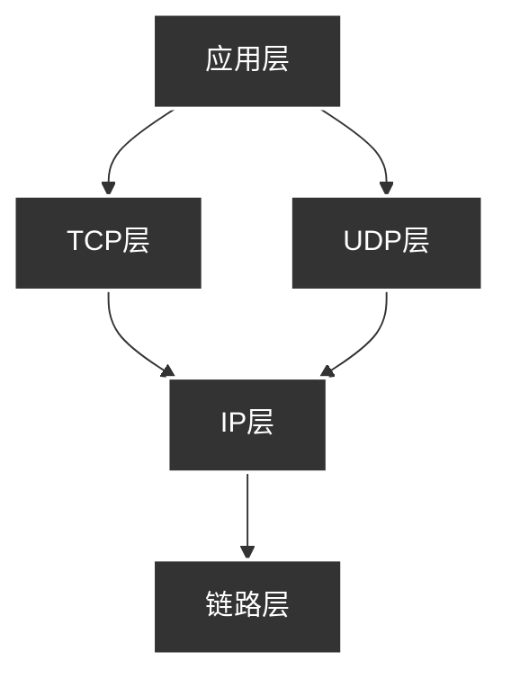
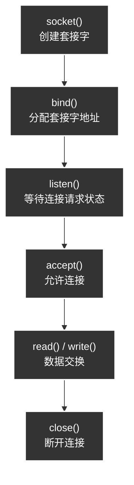
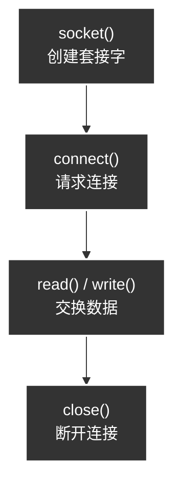

## TCP/IP协议栈

TCP/IP协议栈分为4层：



OSI7层是一种理论标准，这里的TCP/IP的4层协议栈是工程实现。对于程序员来说掌握4层的协议栈就够了。

### 链路层

链路层是硬件相关的，标准分为两大类：有线和无线

- 有线局域网
- 无线局域网
- 广域网/其它

IEEE又把链路层细分为两个子层

```text
┌─────────────────────────────┐
│  LLC 子层（逻辑链路控制）      │ ← 802.2，与上层接口
├─────────────────────────────┤
│  MAC 子层（介质访问控制）      │ ← 802.3/802.11，管寻址和信道
└─────────────────────────────┘
```

- **MAC 子层**：管 MAC 地址、信道争用（谁先发）。
- **LLC 子层**：给上层（网络层）提供统一接口。

其中链路层用MAC地址(物理地址)来标识设备，数据每经过一级，链路层的MAC地址就换一次；IP地址始终不变。

```text
主机A ──→ 路由器1 ──→ 路由器2 ──→ 主机B

MAC:  A→R1      R1→R2      R2→B     （每跳都变）
IP:   A ──────────────────────→ B   （端到端不变）
```

> 链路层负责**相邻节点之间的"一跳"传输**，用 **MAC 地址**寻址，主要标准是**以太网（有线）和 Wi-Fi（无线）**。它把网络层交下来的 IP 包封装成**帧**发出去，每经过一个路由器就重新封装一次——所以 MAC 地址每跳都变，而 IP 地址从头到尾不变。

```text
┌──────────┬──────────┬──────────┬──────────┬─────────┐
│ 目的MAC   │ 源MAC    │ 类型      │  数据     │ 校验CRC │
│  6字节    │  6字节   │  2字节    │ (IP包)    │  4字节  │
└──────────┴──────────┴──────────┴──────────┴─────────┘
        帧头                                    帧尾
```

### IP层

链路层解决了物理链接的问题，而IP层解决的就是在复杂的网络中传输数的问题。其中最重要的就是路径的选择，向目标传输数据需要经过哪些路径？

IP协议本身是面向消息的，不可靠的协议。每次传输数据时会帮我们选择路径。如果传输中发生路径错误，则选择其它路径；如果发生了数据丢失或错误则无法解决，所以IP协议无法解决数据错误的问题。

### TCP/UDP层

IP层解决了数据传输中的路径选择问题，只需要按照此路径传输数据即可。而TCP/UDP则以IP层提供的路径信息完成实际的数据传输。其中TCP可以保证可靠的数据传输，因此TCP协议确认后向不可靠的IP协议赋予了可靠性。

### 应用层

应用层之下的内容是套接字通信过程中自动处理的。选择数据的传输路径、数据的确认过程都被隐藏到了套接字内部。因此程序员编程无需考虑这些底层细节。只需要利用套接字的规则编写出程序即可。在编写程序的过程中，需要根据程序的特点决定服务器端和客户端之间的数据传输规则，这就是应用层协议，网络编程的大部分内容就是设计并实现应用层的协议。

## 实现基于TCP的服务器端/客户端

### TCP服务器端的默认函数调用顺序



`socket()`和`bind()`解决了协议和地址的问题。而`listen()`之后的内容属于连接管理和数据通信，是套接字真正作为通信端点开始工作的阶段。

### 进行等待连接请求状态`listen()`

只有调用了`listen`函数，客户端才能进入可发出连接请求的状态。

```c
#include <sys/socket.h>

int listen(int sock, int backlog)
// sock 套接字的文件描述符(监听套接字)
// backlog 连接请求等待队列的长度，表示最多有几个请求进入队列
```

### 受理客户端连接请求`accept()`

调用 `listen()` 后，套接字进入**监听状态**，负责接收新的连接请求。当有连接到来时，`accept()` 从连接队列中**取出一个已建立的连接**，并**创建一个新的套接字**来代表这条连接。

于是形成**两个套接字分工**：

- **监听套接字**（`listen_fd`）：**始终监听**，只接收新连接，不处理数据；
- **连接套接字**（`conn_fd`）：**每条连接一个**，专门负责这条连接的数据收发。

服务端通常**循环**调用 `accept()`，从而用**一个监听套接字**服务**多个连接套接字**——这正是 TCP 服务端能同时服务多个客户端的机制。

```c
#include <sys/socket.h>

int accept(int sock, struct sockaddr* addr, socklen_t* addrlen);
// sock 监听套接字文件描述符
// addr 保存发起连接请求的客户端地址信息
// addrlen 第二个参数的长度
// 返回值为创建的连接套接字的文件描述符，失败返回-1
```

其中连接套接字是自动创建的，并自动与发起连接的客户端建立连接。

### 服务器端代码

```c
#include <netinet/in.h>
#include <stdio.h>
#include <stdlib.h>
#include <string.h>
#include <unistd.h>
#include <arpa/inet.h>
#include <sys/socket.h>

// 错误处理函数
void error_handling(char* message) {	
    fputs(message, stderr);
    fputc('\n', stderr);
    exit(1);
}

int main(int argc, char* argv[]) {
    int serv_sock;	// 客户端监听套接字
    int clnt_sock;	// 连接套接字：accept返回

    struct sockaddr_in serv_addr; //服务器端地址结构体 IP+端口
    struct sockaddr_in clnt_addr; // 客户端地址结构体 accept时填入
    socklen_t clnt_addr_size; //客户端地址结构体长度

    char message[] = "Hello World!";	//发送的数据

    // 命令行必须带一个参数：端口号
    if(argc != 2) {
        printf("Usage : %s <Port>\n", argv[0]);
        exit(1);
    }

    //调用socket函数创建套接字
    serv_sock = socket(PF_INET, SOCK_STREAM, 0);    
    if(serv_sock == -1)
        error_handling("socket() error");

    // 准备服务器端地址
    memset(&serv_addr, 0, sizeof(serv_addr)); //先清零，避免残留垃圾值
    serv_addr.sin_family = AF_INET;			  // 地址族
    serv_addr.sin_addr.s_addr = htonl(INADDR_ANY); // 主机字节序->网络字节序
    serv_addr.sin_port = htons(atoi(argv[1]));     // 端口号转16位网络字节序

    // 调用bind函数分配IP地址和端口号
    if(bind(serv_sock, (struct sockaddr*) &serv_addr, sizeof(serv_addr)) == -1)
        error_handling("bind() error");

    // 调用listen函数将套接字转换为可接受连接状态
    if(listen(serv_sock, 5) == -1)
        error_handling("listing() error");

    clnt_addr_size = sizeof(clnt_addr);
    // 调用accept函数受理连接请求，如果没有连接请求，则一直阻塞，直到有连接请求为止
    clnt_sock = accept(serv_sock, (struct sockaddr*)&clnt_addr, &clnt_addr_size);

    if(clnt_sock == -1)
        error_handling("accept() error");

    // 传输数据
    write(clnt_sock, message, sizeof(message));
    //关闭连接套接字
    close(clnt_sock);
    //关闭监听套接字
    close(serv_sock);
    return 0;
}
```

### TCP客户端的默认函数调用顺序



客户端实现过程中不需要对套接字地址进行分配，而是创建套接字后立刻调用`connect()`，客户端的地址分配发生在调用connect函数时，由操作系统进行。

```c
#include <sys/socket.h>

int connect(int sock, struct sockaddr* servaddr, socklen_t addrlen);
// sock 客户端套接字文件描述符
// servaddr 保存服务器端地址信息
// 第二个变量的长度
```

客户端调用connect函数后，发生以下情况才会返回

- 服务器端接收连接请求(只是加入等待队列，并不表示服务器端调用accept)
- 发生异常情况中断连接请求

```c
#include <stdio.h>        
#include <stdlib.h>      
#include <string.h>      
#include <unistd.h>     
#include <arpa/inet.h>   
#include <sys/socket.h>  

// 错误处理函数：打印错误信息到标准错误，然后退出程序
void error_handling(char *message) {
    fputs(message, stderr);   // 把错误信息写到 stderr（立刻显示，不缓冲）
    fputc('\n', stderr);      // 补一个换行
    exit(1);                  // 退出程序，返回码 1 表示异常
}

int main(int argc, char* argv[]) {
    int sock;                        // 客户端套接字文件描述符
    struct sockaddr_in serv_addr;    // 服务端地址结构体（存服务端 IP + 端口）
    char message[30];                // 接收服务器数据的缓冲区
    int str_len;                     // read 实际读到的字节数

    // 命令行必须带两个参数：服务端 IP 和端口号
    // 用法：./client 127.0.0.1 9190
    if (argc != 3) {
        printf("Usage : %s <IP> <port>\n", argv[0]);
        exit(1);
    }

    // 1) 创建套接字
    //    PF_INET     → IPv4 协议族
    //    SOCK_STREAM → 面向连接的 TCP（字节流）
    //    0           → 自动选择协议（TCP）
    //    注意：此时套接字还不区分"服务端/客户端"，只是创建出来而已
    sock = socket(PF_INET, SOCK_STREAM, 0);
    if (sock == -1)
        error_handling("socket() error");

    // 2) 准备"要连接的服务端"地址结构体
    memset(&serv_addr, 0, sizeof(serv_addr));   // 先清零，避免残留垃圾值
    serv_addr.sin_family = AF_INET;             // 地址族：IPv4

    // 服务端 IP 来自命令行字符串，如 "127.0.0.1"
    // inet_addr 把字符串 IP 转成 32 位整数，且已是网络字节序（所以不用再 htonl）
    serv_addr.sin_addr.s_addr = inet_addr(argv[1]);

    // 端口号来自命令行字符串，atoi 转整数，htons 转 16 位网络字节序
    serv_addr.sin_port = htons(atoi(argv[2]));

    // 3) connect：主动向服务端发起连接请求（触发 TCP 三次握手）
    //    成功返回 0，失败返回 -1
    //    连接建立后，才能用 sock 收发数据
    if (connect(sock,
                (struct sockaddr*)&serv_addr,   // 服务端地址（转成通用 sockaddr）
                sizeof(serv_addr)) == -1)       // 地址结构体长度
        error_handling("connect() error!");

    // 4) 读取服务端发来的数据
    //    read(fd, buf, len)：从套接字读最多 len 字节
    //    这里用 sizeof(message)-1，给字符串末尾留一个 '\0' 的位置
    str_len = read(sock, message, sizeof(message) - 1);
    if (str_len == -1)
        error_handling("read() error!");

    // 5) 打印收到的消息
    //    注意：message 没有手动加 '\0'，但 memset 后缓冲区是 0，
    //    且只读了 size-1 字节，末尾仍保留 0，所以可当字符串打印
    printf("Message from server : %s \n", message);

    // 6) 关闭套接字，断开连接
    close(sock);
    return 0;
}
```

## TCP原理

### 原理1 与对方套接字的连接

TCP套接字从创建到消失的过程分为3步

- 与对方套接字建立连接
- 与对方套接字进行数据交换
- 断开与对方套接字的的连接

这个过程被称为三次握手。套接字是以全双工方式工作的，也就是说它可以双向传递数据。因此收发数据前需要做一些准备：

```
[SYN] : 同步消息，客户端->服务端
[SYN+ACK] : 确认消息 + 同步消息
[ACK] : 最终确认
```

### 原理2 与对方主机的数据交换

>  TCP 内部交换数据的本质是：**把字节流切成带序号的报文段发出去，接收方按序号重排并回 ACK，发送方对没确认的段重传**——**序号 + ACK + 重传 + 滑动窗口 + 校验和**这五个机制协同，才实现了"不丢、有序、无边界"的可靠字节流。握手只负责开关连接，真正的数据交换靠这套机制。

### 原理3 断开与套接字的连接

断开连接需要经过四次挥手：

```text
[FIN] 客户端->服务端
[ACK] 服务端确认
[FIN] 服务端->客户端
[ACK] 客户端确认
```

一共四次是因为TCP全双工，两个方向都要关闭。比握手阶段多一次是因为，服务端收到SYN后可以同时回SYN+ACK，而挥手时，服务端收到FIN，只能先回ACK，因为可能还有数据要发，等自己数据发完再发FIN。
