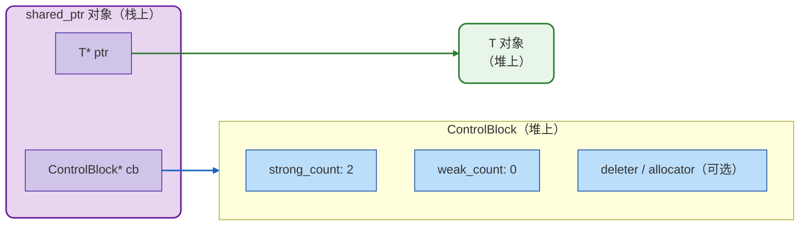

## 共享所有权

`shared_ptr`表达的是共享所有权的语义，多个`shared_ptr`可以指向同一个对象，它们共同决定对象的生命周期。只有当最后一个`shared_ptr`被销毁时，对象才会被delete。

但是共享所有权不是免费的，每个`shared_ptr`的拷贝和析构都需要更新引用计数，而且引用计数必须是线程安全的(原子操作)。此外`shared_ptr`内部还维护了一个控制块来存储引用计数和其它元信息。这些开销在频繁创建和销毁`shared_ptr`的场景下会变得非常明显。

## 控制块：`shared_ptr`的内部结构

一个`shared_ptr`实际上包含两个指针：一个指向被管理的对象，另一个指向控制块。

当使用`std::make_shared`创建`shared_ptr`时，对象和控制块会被放在同一个内存块中(一次分配)；而使用`std::shared_ptr<T>(new T)`时，对象和控制块是两次独立的分配。



其中控制块包含强引用计数(`shared_ptr`的数量)、弱引用计数(`weak_ptr`的数量)、自定义删除器和自定义分配器。这些内容是需要持久存在，伴随着一个`shared_ptr`的生命周期，所以需要一个堆上的数据结构。

## `make_shared`

前面提到了,`make_shared`把对象和控制块放在一个连续的内存块里，这会带来三个显著的好处：

- 更少的堆分配次数：从两次减少为一次。
- 更好的缓存局部性：对象和控制块在同一个内存块内，CPU缓存行可能同时命中两者。
- 更少的内存碎片：一次分配意味着一次释放，而不是在两个位置上各释放一次。

```c++
// 推荐：单次分配
auto p1 = std::make_shared<Connection>("10.0.0.1:9090");

// 不推荐：两次分配，且不如 make_shared 异常安全
auto p2 = std::shared_ptr<Connection>(new Connection("10.0.0.1:9090"));

// 大小对比
std::cout << "sizeof(shared_ptr): " << sizeof(p1) << "\n";  // 16 (64-bit)
std::cout << "sizeof(unique_ptr): " << sizeof(std::unique_ptr<Connection>) << "\n";  // 8
```

## 引用计数的原子操作和线程安全

`shared_ptr` 的引用计数使用原子操作来保证线程安全。这意味着在多线程环境下，您可以安全地拷贝和销毁 `shared_ptr` 本身（引用计数的增减是原子的），但**被管理对象的访问并不受保护**——如果您有多个线程同时读写对象本身，仍然需要自行加锁。

## Aliasing Constructor(别名构造函数)

`shared_ptr` 有一个非常强大但不太为人知的构造函数，叫做 **aliasing constructor**。它的签名是：

```c++
template <typename U>
shared_ptr(const shared_ptr<U>& r, T* ptr) noexcept;
```

这个构造函数会创建一个新的`shared_ptr`，它共享`r`的所有权，但`get()`返回的是`ptr`而不是`r.get()`。**它让您持有同一个对象的"一部分"，而不需要单独管理那部分的生命周期**。

```text
        shared_ptr<T> (新)              shared_ptr<U> r (已有)
        ┌──────────────┐                ┌──────────────┐
        │ T* ptr ──────┼──┐             │ U* ptr ──────┼──→ 真实对象
        │ cb ──────────┼──┼────────────→│ cb ──────────┼──→ ControlBlock
        └──────────────┘  │             └──────────────┘
                          │
                          ↓
                    ptr 指向的对象
                （真实对象的一部分）
```

最常见的用途是访问对象的成员：

```c++
struct Config {
    std::string host;
    int port;
    std::string db_name;
};

auto config = std::make_shared<Config>();

// 获取一个指向 config->host 的 shared_ptr
// 它共享 config 的引用计数——只要有人持有 host_ptr，config 就不会被销毁
std::shared_ptr<std::string> host_ptr(config, &config->host);

// 在另一个组件中使用 host_ptr，不需要知道 Config 的存在
void connect(const std::shared_ptr<std::string>& host) {
    std::cout << "Connecting to " << *host << "\n";
}
```

这个特性在实现"指向容器元素的智能指针"时特别有用——比如您想返回一个指向 `vector` 中某个元素的 `shared_ptr`，但又不想让调用者持有整个 `vector` 的 `shared_ptr`。通过 aliasing constructor，您可以返回一个只暴露元素类型的 `shared_ptr`，而底层仍然由容器的 `shared_ptr` 管理生命周期。

## `enable_shared_from_this`

有时候，对象的成员函数需要返回一个指向自身的 `shared_ptr`。最直觉的写法 `shared_ptr(this)` 是致命错误——它会创建一个新的控制块，导致对象被 delete 两次。正确的做法是继承 `std::enable_shared_from_this` 并调用 `shared_from_this()`：

```c++
class Widget : public std::enable_shared_from_this<Widget> {
public:
    std::shared_ptr<Widget> getSelf() {
        return shared_from_this();   // 正确
    }
};
```

> `shared_ptr(this)` 之所以致命，是因为它**不知道对象已经有一个 ControlBlock**，于是新建了第二个，导致同一对象被两套引用计数系统各自销毁一次。

> `enable_shared_from_this` 的解法是：**让对象在第一次被 `shared_ptr` 接管时，把那个 ControlBlock 记在自己身上（`weak_this`）**。之后成员函数通过 `shared_from_this()` 就能取出同一个 ControlBlock，生成共享所有权的 `shared_ptr`，而不会新建 ControlBlock，也就不会 double free。

> 前提是：**对象必须已经被 `shared_ptr` 接管**，否则 `weak_this` 为空，`shared_from_this()` 会抛 `std::bad_weak_ptr`。

